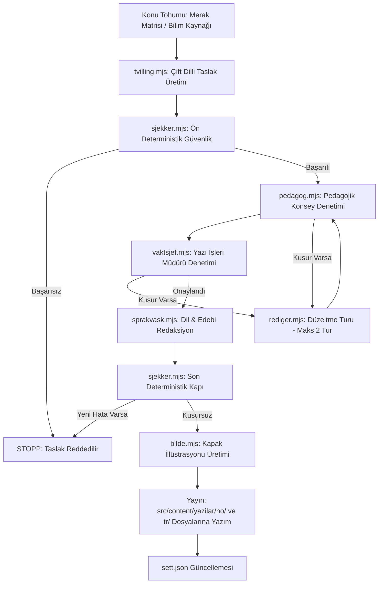

# Yazı İşleri Müdürlüğü ve Pedagojik Konsey (Redaksjonell Ledelse & Pedagogisk Råd) Tasarım Dokümanı

- **Proje:** leyum (Et nysgjerrig og fargerikt barnemagasin / Meraklı ve rengarenk çocuk dergisi)
- **Tarih:** 2026-10-10
- **Durum:** Onaylandı (Ready for Implementation Plan)
- **Kapsam:** Yapay zekâ destekli editoryal yönetim merkezi, pedagojik denetim kurulu, Norveç medya hukuku ve çocuk hakları uyumu, çift dilli (Norveççe Bokmål ve Türkçe) içerik üretim ve doğrulama hattı.

---

## 1. Giriş ve Amaç

`leyum`, 4–12 yaş arası çocuklara ve ailelerine/öğretmenlerine yönelik, kâr amacı gütmeyen, reklamsız, takip çerezsiz, iki dilli (Norveççe Bokmål ve Türkçe) bir çocuk dergisidir.

Bu tasarım dokümanı; `tidsrost` projesindeki yapay zekâ yazı işleri denetim hattını temel alarak, çocuk edebiyatının ve pedagojisinin hassasiyetlerine, Norveç medya hukukuna, basın etiğine ve uluslararası çocuk hakları standartlarına tam uyumlu bir **Yazı İşleri Müdürlüğü (Redaksjon)** ve **Pedagojik Konsey (Pedagogisk Råd)** sistemi kurmayı hedefler.

Sistem, yapay zekâ tarafından üretilen her türlü içeriği insan kalitesinde, pedagojik olarak kusursuz, bilimsel olarak doğru ve dilsel olarak zengin kılacak çok katmanlı bir denetim mekanizmasına sahip olacaktır.

---

## 2. Hukuki, Etik ve Pedagojik Dayanaklar

Yazı İşleri motoru aşağıdaki yasal ve kurumsal düzenlemeleri kodlanmış kurallar olarak işletir:

### 2.1 Norveç Basın Etiği ve Medya Standartları
1. **Vær Varsom-plakaten (VVP) § 4.8 (Barns rettigheter):**
   * Çocukların savunmasızlığı, güvenliği ve mahremiyeti esastır. Çocukları korkutan, rencide eden, yetişkin çatışmalarının nesnesi yapan veya istismara açık hale getiren hiçbir anlatıya izin verilmez.
2. **Vær Varsom-plakaten § 3.2 (Kildekritikk og faktasjekk):**
   * Bilimsel gerçekler, doğa olguları ve tarihi bilgiler doğrulanmış kaynaklara dayanmalıdır. Uydurma veriler ve kanıtlanmamış iddialar kesinlikle elenir.
3. **Vær Varsom-plakaten § 4.4 (Titler og ingress):**
   * Tık tuzağı (clickbait), sansasyonellik, abartılı ve kaygı uyandırıcı başlıklar yasaktır. Başlık metnin içeriğini dürüstçe yansıtmalıdır.
4. **Redaktørplakaten (Yayın Yönetmeni Bildirgesi):**
   * Editoryal bağımsızlık, doğruluk ve kamu yararına sorumlu yayıncılık.

### 2.2 Norveç Mevzuatı ve Düzenleyici Kurumlar
1. **Medietilsynet & Bildeprogramloven (Norveç Medya Kurumu & Görsel Programlar Kanunu):**
   * Çocukları zararlı içerikten koruma yükümlülüğü. Şiddet, aşırı korku, dehşet, kabus sahneleri ve cinsellik mutlak surette engellenir.
   * Yaş sınıflandırması (`4-6`, `7-9`, `10-12`) ve bu yaş gruplarının duygusal eşiklerine tam riayet.
2. **Barnekonvensjonen (UNCRC) Madde 17 (Norveç İnsan Hakları Kanunu § 2):**
   * Çocuğun zihinsel, ruhsal ve ahlaki gelişimini destekleyen; çok yönlü, merak aşılayan, dünyayı sevdiren nitelikli bilgiye erişim hakkı.
3. **Forbrukertilsynet & Markedsføringsloven § 19 (Tüketici Kurumu - Çocuklar ve Gençler):**
   * Çocuklara yönelik doğrudan ticari baskı, reklam, sponsorlu içerik ve satın alma yönlendirmelerinin mutlak yasaklanması (`leyum` %100 reklamsızdır).
4. **Datatilsynet & Personopplysningsloven (GDPR Madde 8):**
   * Sıfır kullanıcı takibi, sıfır çerez, sıfır çocuk verisi toplama.

### 2.3 Pedagojik ve Edebi Standartlar
1. **Språkrådet & Foreningen !les / NBU (Norske Barne- og Ungdomsbokforfattere):**
   * Okuma sevgisi (*leseglede*), zengin kelime dağarcığı, yaşayan Bokmål normları, yabancı dilden doğrudan kopyalanan çeviri kokularının (anglisismer) temizlenmesi.
2. **Pedagojik Güvenlik (Çocuk Gelişim Psikolojisi):**
   * **Eko-Anksiyete Engeli:** İklim ve çevre konularında "dünya yok oluyor" gibi çocukta felç edici kaygı oluşturan söylemler yerine; doğanın mucizeleri, adaptasyonlar ve çocukların yapabileceği somut, umut verici adımlar vurgulanır.
   * **Pozitif Değerler:** Empati, çeşitlilik, merak, bilimsel düşünce, yardımlaşma ve keşif sevinci.
3. **Türkçe Çocuk Edebiyatı Kriterleri (TDK & Pedagojik İlkeler):**
   * Duru, akıcı ve sıcak bir Türkçe; yapay ve didaktik azarlamalardan uzak, çocuğun iç sesine hitap eden edebi ritim.

---

## 3. Sistem Mimarisi ve Modül Haritası

Sistem `scripts/redaksjon/` dizininde modüler bir mimariyle konumlandırılır:

```text
scripts/redaksjon/
├── lib.mjs                 # Gemini API (responseSchema), dosya I/O, slug, markdown yardımcıları
├── lover-og-regler.mjs     # VVP 4.8, Medietilsynet, Barnekonvensjonen ve pedagoji kural kütüphanesi
├── sjekker.mjs             # Ön ve son deterministik testler (LIX, cümle boyu, kara liste, tipografi)
├── pedagog.mjs             # Pedagojik Denetçi Masası (Duygusal güvenlik, yaş uygunluğu, umut endeksi)
├── vaktsjef.mjs            # Yazı İşleri Müdürü Masası (Olgusal doğruluk, anlatı kurgusu, etik/yasa)
├── sprakvask.mjs           # Dil Masası (Bokmål Språkrådet & Türkçe TDK kuralları, ritim)
├── tvilling.mjs            # Çift Dilli İkiz Üretici (Norveççe & Türkçe eşzamanlı yaratıcı adaptasyon)
├── bilde.mjs               # İkili Görsel Masası (Imagen 3 / Gemini + Folio SVG/WebP yedek kapak)
├── rediger.mjs             # Çok aşamalı editoryal döngü (taslak -> denetim -> düzeltme -> onay / STOPP)
├── uret.mjs                # Terminalden interaktif veya parametrik tekil üretim CLI'ı
├── redaksjon-bot.mjs       # GitHub Actions için otomatik periyodik dergi üretim botu
└── sett.json               # Üretilen konuların ve tohumların tekrarını önleyen durum kütüğü
```

---

## 4. Editoryal Denetim Hattı (Pipeline)



### 4.1 Çoklu Rol Denetim Ayrıntıları
* **Pedagog (Pedagogisk Vaktsjef):**
  * Yaş basamağına bilişsel uygunluk.
  * Duygusal güvenlik (korku, panik, suçluluk yokluğu).
  * Merak uyandırma ve umut aşılama katsayısı.
* **Yazı İşleri Müdürü (Ansvarlig Redaktør):**
  * Kategori ve anlatı kurgusu tutarlılığı.
  * Bilimsel olguların doğruluğu (faktasjekk).
  * VVP 4.8 ve Medietilsynet kriterleri.
* **Språkvasker (Bokmål & Türkçe):**
  * Bokmål: Språkrådet normları, `« »` tırnaklar, `–` replik çizgileri, `i går/i dag` temizliği, Nynorsk sızıntı engeli.
  * Türkçe: TDK kuralları, `“ ”` tırnaklar, `—` çizgiler, zengin çocuk edebiyatı kelime dağarcığı.

---

## 5. Deterministik Filtreler ve Ölçütler

Yapay zekânın inisiyatifine bırakılmayan katı kurallar:

| Yaş Grubu | Maks. Cümle Uzunluğu | Paragraf Yapısı | Hedef LIX Puanı | Pedagojik Odak |
|---|---|---|---|---|
| **4–6 Yaş** | 12 kelime | 1–2 cümle | < 25 (Çok Kolay) | Ritmik, somut, görsel, güven verici |
| **7–9 Yaş** | 18 kelime | 2–3 cümle | 25–35 (Kolay) | Sebep-sonuç, merak, mizah, keşif |
| **10–12 Yaş**| 24 kelime | 3–4 cümle | 35–45 (Orta/Edebi) | Bilimsel derinlik, eleştirel düşünce, empati |

### Kara Liste (Tetikleyici Kelimeler)
* Şiddet, kan, dehşet, kabus, cinsel öğeler, intihar, kendine zarar verme, yabancı tehlikesi abartısı, çocuk kaçırma, katastrofik iklim çöküşü dili tespit edildiğinde sistem acil durdurma (`STOPP`) uygular.

---

## 6. Görsel Üretimi ve Yedeklik Mimarisi

* **Birincil Görsel Motoru:** Imagen 3 / Gemini API ile İskandinav çocuk edebiyatı suluboya/pastel tarzında, neşeli, merak dolu illüstrasyon üretimi.
* **Görsel Güvenlik Filtreleri:** Sıkı negatif promptlar (korkutucu, karanlık, tekinsiz insan yüzleri, canavarlar vb. engellenir).
* **İkincil Yedek Motoru (Storybook Folio SVG/WebP):** API hatası veya kota durumunda `DESIGN.md` tasarım sistemimizin renk ve tipografi tokenlarını (`Fraunces` başlıklar, `#FAF6ED` zemin, kategori renkleri) kullanan yüksek kaliteli editoryal kapak kartı otomatik oluşturulur.

---

## 7. Yürütme ve Otomasyon

1. **CLI Arayüzü (`npm run redaksjon:uret`):**
   * Seçenekli etkileşimli üretim (kategori, yaş, özel konu).
2. **Denetim Aracı (`npm run redaksjon:denetle`):**
   * Mevcut yazıları tarayıp pedagojik ve dil uyumunu raporlayan test aracı.
3. **GitHub Actions (`.github/workflows/redaksjon.yml`):**
   * Belirlenen takvimde (örn. haftalık) çalışan, başarı durumunda repoya commit atarak Cloudflare Pages dağıtımını tetikleyen otomatik iş akışı.

---

## 8. Kamusal Şeffaflık ve Tüzük Sayfası

Siteye eklenen kurumsal sayfalar:
* `/no/redaksjon` (Norveççe)
* `/tr/yazi-isleri` (Türkçe)

İçerik:
* Vær Varsom-plakaten § 4.8 ve Redaktørplakaten taahhüdü.
* Medietilsynet ve Barnekonvensjonen Madde 17 beyanı.
* %100 Reklamsız, ticari baskısız, sıfır takip güvencesi.
* Pedagojik Konsey ilkeleri ve yaş grubu rehberi.
* Şeffaf Yapay Zekâ Etiği beyannamesi.
* Sitenin Header/Footer menülerinde prestijli erişim linkleri.

---

## 9. Başarı Kriterleri

1. Yapay zekâ tarafından üretilen tüm içeriklerin pedagojik, etik ve dilsel kontrollerden 0 hatayla geçmesi.
2. Norveç basın etiği ve Medietilsynet yönergelerine %100 uyum.
3. Çift dilli eşzamanlı içeriklerin birbirine çeviri kokmadan, kendi dillerinde edebi değer taşıması.
4. Görsel üretiminde API kesintilerine karşı yedek mekanizmanın sorunsuz çalışması.
5. Kamusal tüzük sayfasının hem Norveççe hem Türkçe canlı yayında eksiksiz yer alması.
